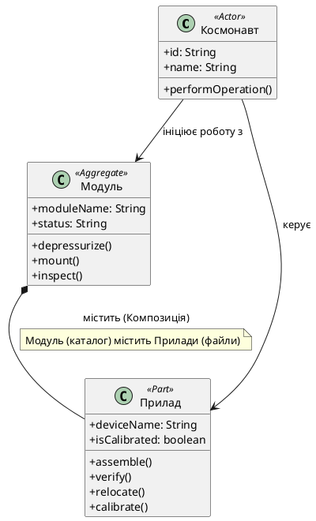

# Контрольна робота №1 

Виконав: Студент групи АС-243 Молчанов Г.І.

Варінат 13 «Космічна станція»

Етап 1. Визначення предметних аналогів базових об’єктів файлової системи
---
Три основні сутності:
Рольовий клас (`Actor`): Космонавт (актор предметної області, який ініціює та виконує всі операції).

Клас-контейнер (`Aggregate`): Модуль (аналог каталогу/директорії файлової системи, який містить інші сутності — прилади).

Клас-елемент (`Part`): Прилад (аналог файлу, який знаходиться всередині модуля та над яким виконуються локальні технічні операції).

Етап 2. Семантичні відповідності між операціями ПрО та Bash-командами
---
Базова модель розбита на дві групи операцій: загальні операції над модулем (контейнером) та локальні операції над приладом (елементом).
| № | Операція ПрО | Операція Bash | Базова Bash-команда | Обґрунтування вибору |
|---|---|---|---|---|
| 1 | Розгерметизувати модуль | Видалити каталог | `rm -rf` / `rmdir` | Знищення структури каталогу-контейнера (модуля). |
| 2 | Увійти до модуля | Змінити поточний каталог | `cd` | Перехід всередину каталогу-контейнера для подальшої роботи з його вмістом. |
| 3 | Змонтувати модуль | Створити каталог | `mkdir` | Створення нового каталогу-контейнера (модуля) в системі. |
| 4 | Оглянути модуль | Вивести вміст каталогу | `ls` | Перегляд списку елементів (приладів), що містяться в модулі. |
| 5 | Скласти прилад | Створити файл | `touch` / `cat >` | Ініціалізація та створення нового файлу-елемента (приладу). |
| 6 | Перевірити прилад | Вивести вміст файлу | `cat` / `less` | Зчитування та перевірка поточного стану файлу-елемента. |
| 7 | Переставити прилад | Перемістити файл | `mv` | Зміна розташування або перейменування файлу-елемента. |
| 8 | Відкалібрувати прилад | Змінити права / налаштувати | `chmod` / налаштування | Зміна параметрів доступу чи конфігурації файлу-елемента. |

 Етап 3. UML-діаграма концептуальних класів ПрО
---
Для візуалізації предметної області було розроблено діаграму класів у нотації PlantUML. Вона відображає ролі актора (Космонавт), контейнера (Модуль) та елемента (Прилад), а також зв'язки між ними.

Діаграма зроблена у PlantText:

  
   
  <em>Рисунок 1 — UML-діаграма концептуальних класів предметної області «Космічна станція»</em>

Інструкція з перевірки аліасів:
---
